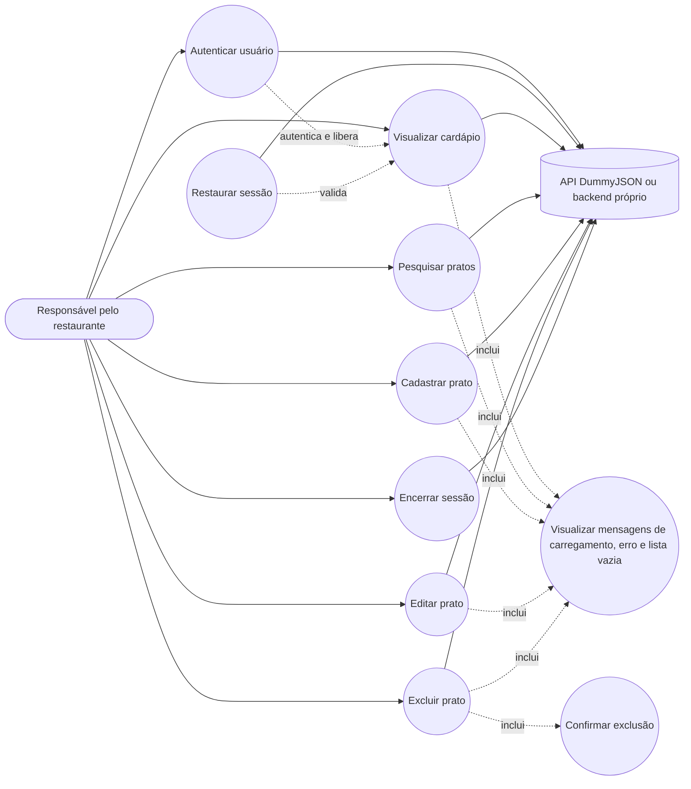
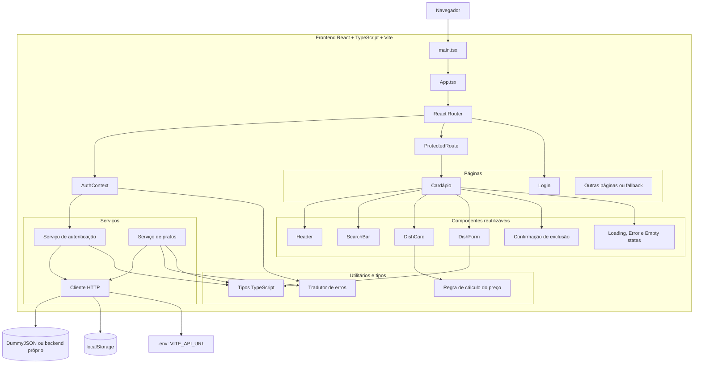
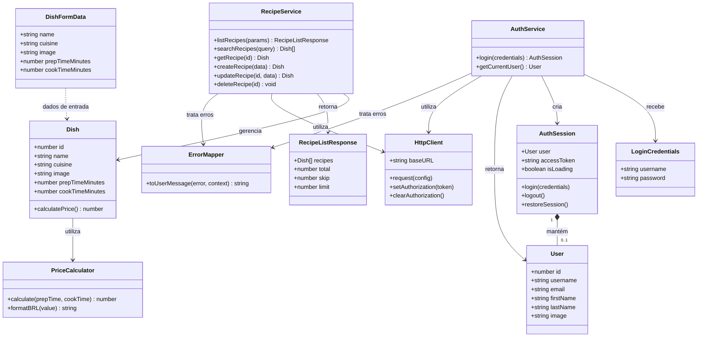
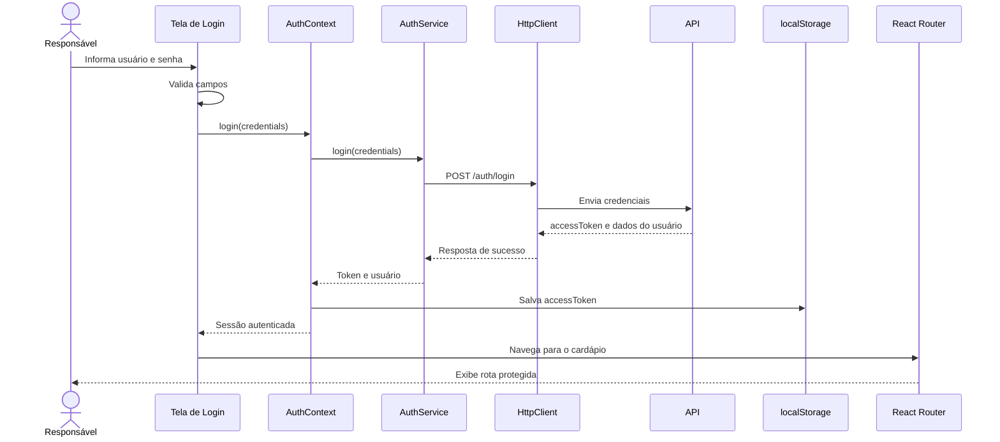
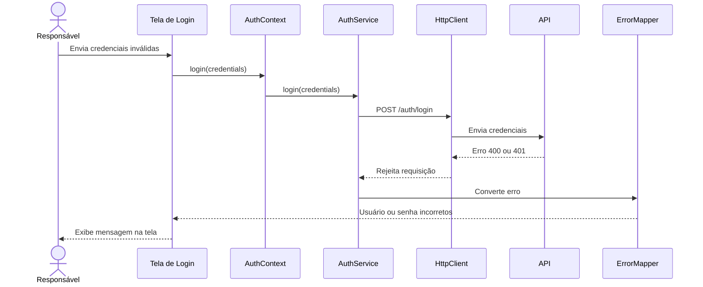
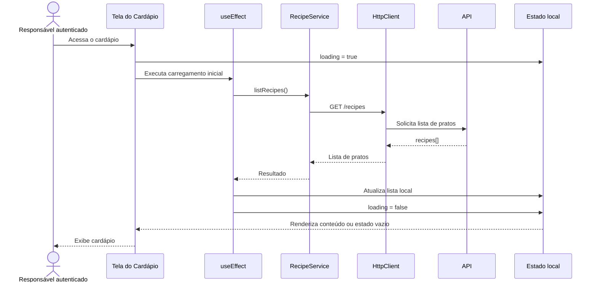
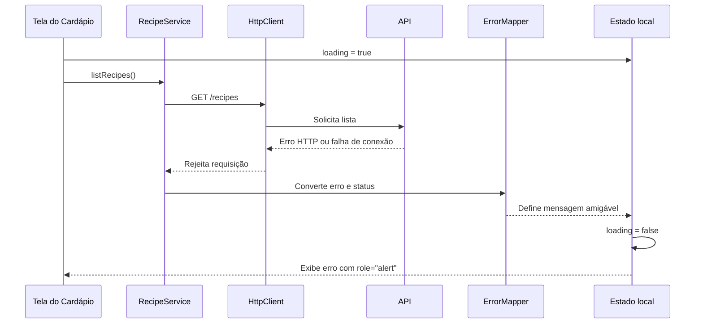
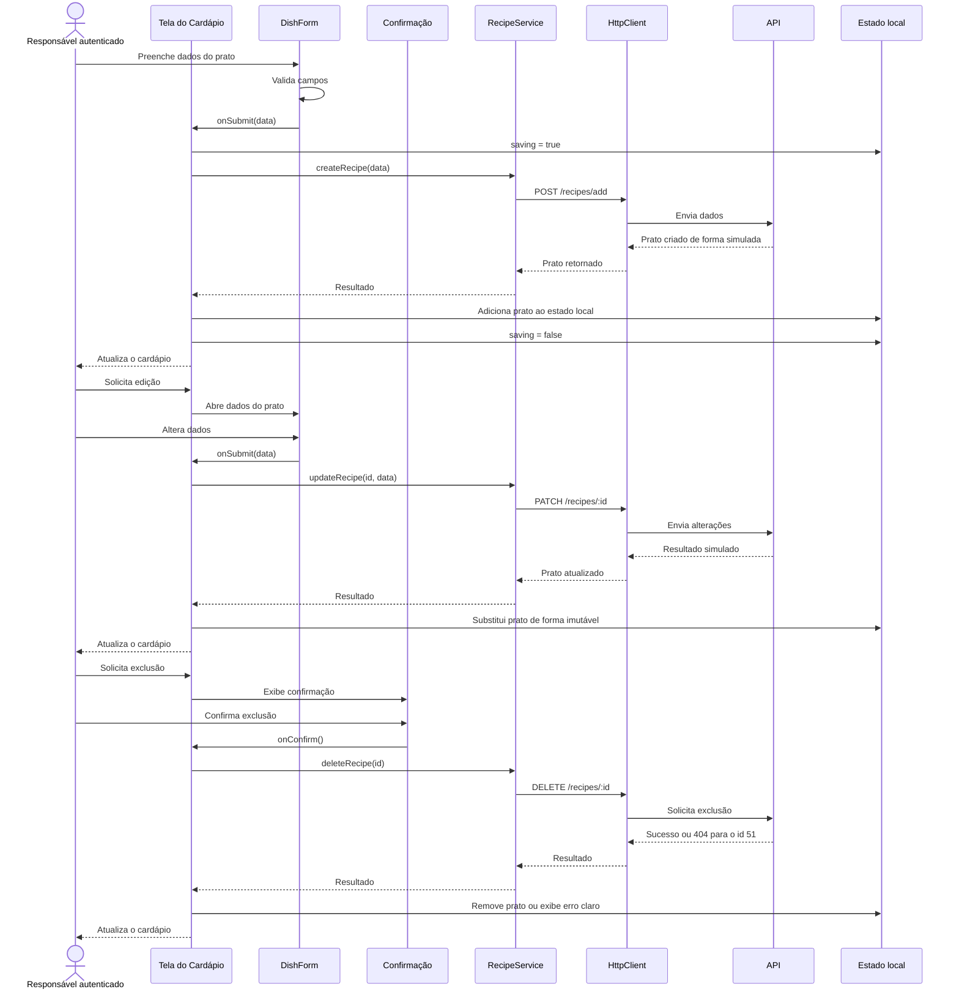
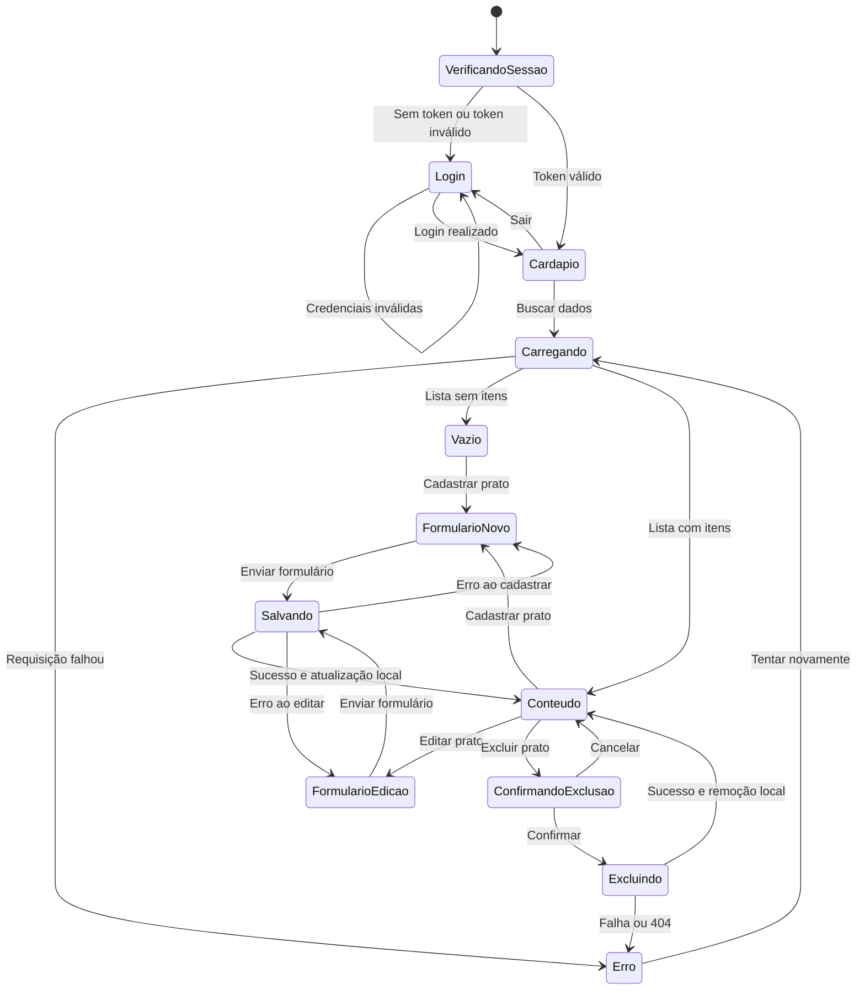

# UML — Projeto Delivery

## 1. Escopo do sistema

O sistema representa o painel administrativo de um restaurante parceiro de delivery. O usuário responsável pelo restaurante realiza autenticação e gerencia o cardápio, podendo consultar, pesquisar, cadastrar, editar e excluir pratos.

O documento utiliza diagramas Mermaid com notação UML para representar os requisitos funcionais, a organização arquitetural, as entidades principais e os fluxos críticos do sistema.

## 2. Diagrama de casos de uso



### Casos de uso principais

| Caso de uso | Ator | Resultado esperado |
|---|---|---|
| Autenticar usuário | Responsável pelo restaurante | Token recebido, armazenado e sessão iniciada. |
| Restaurar sessão | Sistema | Token existente é validado e o usuário é restaurado, ou a sessão é limpa. |
| Visualizar cardápio | Responsável autenticado | Pratos são carregados e exibidos com foto, nome, cozinha e preço. |
| Pesquisar pratos | Responsável autenticado | Lista exibida é filtrada por nome. |
| Cadastrar prato | Responsável autenticado | Novo prato é enviado e incluído no estado local após sucesso. |
| Editar prato | Responsável autenticado | Dados do prato são atualizados no estado local após sucesso. |
| Excluir prato | Responsável autenticado | Exclusão é confirmada, enviada e refletida no estado local. |
| Encerrar sessão | Responsável autenticado | Token é removido e o acesso protegido é encerrado. |

## 3. Diagrama de componentes e arquitetura



### Responsabilidades dos componentes

| Componente ou módulo | Responsabilidade |
|---|---|
| `main.tsx` | Inicializar a aplicação React. |
| `App.tsx` | Compor a aplicação e a estrutura de rotas. |
| `AuthContext` | Centralizar usuário, token, carregamento da sessão, login e logout. |
| `ProtectedRoute` | Impedir o acesso ao cardápio sem autenticação válida. |
| `Login` | Exibir e validar o formulário de login. |
| `Menu` | Coordenar carregamento, busca e operações do cardápio. |
| `Header` | Exibir a identidade do restaurante e a ação de sair. |
| `DishCard` | Apresentar os dados e as ações de cada prato. |
| `DishForm` | Cadastrar ou editar um prato por meio de formulário controlado. |
| `SearchBar` | Receber o termo de busca. |
| `ConfirmDialog` | Solicitar confirmação antes da exclusão. |
| `Feedback` | Exibir carregando, erro e lista vazia. |
| `AuthService` | Executar operações de autenticação. |
| `RecipeService` | Executar operações relacionadas aos pratos. |
| `Http` | Centralizar base URL, token, requisições e respostas HTTP. |
| `ErrorMapper` | Converter erros técnicos em mensagens compreensíveis. |
| `Price` | Aplicar a regra de cálculo e formatação do preço. |

## 4. Diagrama de classes do domínio



### Regra de preço

```text
preço = 15 + 0,50 × (prepTimeMinutes + cookTimeMinutes)
```

O preço é derivado dos tempos do prato e não deve ser tratado como um campo persistido pela API.

## 5. Diagrama de sequência — login



### Fluxo alternativo de login com erro



## 6. Diagrama de sequência — carregamento do cardápio



### Fluxo alternativo de carregamento com erro



## 7. Diagrama de sequência — criar, editar e excluir prato



## 8. Estados principais da interface



## 9. Regras de implementação representadas no UML

1. O usuário não acessa o cardápio sem uma sessão válida.
2. O token deve ser salvo no `localStorage` após o login.
3. A API deve ser acessada por serviços centralizados, e não diretamente pelos componentes de interface.
4. O cardápio deve manter estados distintos de carregamento, erro, vazio e conteúdo.
5. Criar, editar e excluir devem atualizar o estado local após o sucesso da operação simulada.
6. A exclusão deve exigir confirmação antes da chamada à API.
7. Erros devem ser convertidos em mensagens compreensíveis e exibidos na interface.
8. O preço deve ser calculado a partir dos tempos de preparo e cozimento.
9. A interface deve funcionar em 375 px sem rolagem horizontal.
10. A arquitetura deve permanecer modular, com componentes reutilizáveis e responsabilidades separadas.
